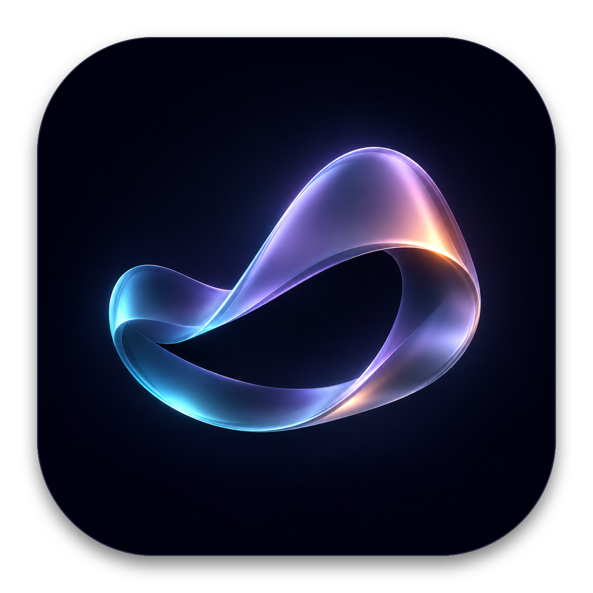
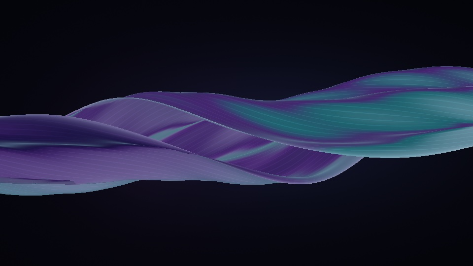
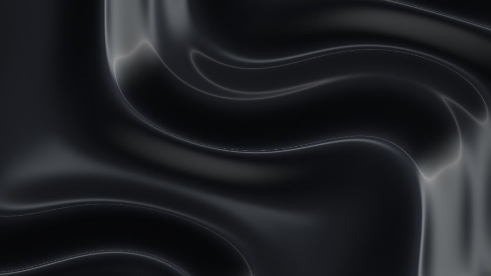

<div align="center">
  
</div>

# Resonance — Live Wallpaper & Music Visualizer for macOS

Resonance is a native Mac live wallpaper app with **45 animated desktop wallpapers**. Play music to drive one of 20 real-time audio-reactive scenes, or choose from 25 ambient wallpapers that animate independently. Metal renders each scene behind your Finder icons.

**[Download Resonance for macOS](https://github.com/DavoodAkrami/resonance-macos-live-wallpaper/releases/latest)** · [Browse all wallpapers](docs/wallpapers.md)

| Music-reactive wallpaper | Ambient live wallpaper |
| --- | --- |
|  |  |
| Liquid Aurora | Obsidian Flow |

## What Resonance does

- **Music wallpapers.** Real-time bass, midrange, treble and beat analysis animate the artwork using Apple Music or system audio. Adjust sensitivity and choose Subtle, Balanced or Expressive motion.
- **Ambient live wallpapers.** Choose minimal color studies, soft glass, liquid metal or warm silk. Seven scenes can respond to the pointer without Accessibility access.
- **Native Mac desktop integration.** Keep Finder icons clickable, choose which displays to use, and restore the normal desktop from the menu bar.
- **Per-wallpaper control.** Adjust the palette, brightness, speed and material, with optional album artwork colors for music scenes.
- **Menu bar startup.** Enable **Open at login** to resume in the background. Open the studio from the menu bar when you want to browse or adjust a wallpaper.
- **Frame-rate control.** Choose Adaptive, 60 FPS or 30 FPS. Battery and covered-desktop settings can reduce rendering activity.

## Download and install

**Requires macOS 14.2 or later and a Metal-capable Mac.** The release contains Apple Silicon and Intel binaries. Tested on Apple Silicon.

1. Download the `.dmg` from the [latest GitHub Release](https://github.com/DavoodAkrami/resonance-macos-live-wallpaper/releases/latest).
2. Open the disk image and drag **Resonance** to **Applications**.
3. Eject the image, open Resonance from Applications and look for the waveform icon in the menu bar.
4. Choose **Open Resonance**, select a scene and click **Apply wallpaper**.

The downloadable community build is ad-hoc signed and has no Apple notarization. macOS may block it on first launch. The release includes a SHA-256 digest, and you can also build directly from this source. [Apple's guidance on opening apps safely](https://support.apple.com/en-us/102445)

## Audio and privacy

Choose **Apple Music** to listen to the running Music app or **System audio** to react to other apps. Enable **System Audio Recording** when macOS asks. The separate **Read track details and artwork from Music** option may request Music Automation access. **Receiving audio** confirms that Resonance detects audible samples.

Ambient wallpapers require zero audio permissions. Resonance processes audio on your Mac in memory and does not use the microphone, record audio files, upload audio or require an account. Some protected sources may supply no audible samples. Try **System audio** with an unprotected local track to check your setup.

## Build and test from source

Open `Resonance.xcodeproj` in Xcode, select the **Resonance** scheme and choose **My Mac**. The Swift and Metal project has no third-party dependencies. It was verified with Xcode 27.2.

```sh
xcodebuild -project Resonance.xcodeproj -scheme Resonance -destination 'platform=macOS' \
  -derivedDataPath build -parallel-testing-enabled NO test
xcodebuild -project Resonance.xcodeproj -scheme Resonance -configuration Release \
  -destination 'generic/platform=macOS' -derivedDataPath build 'ARCHS=arm64 x86_64' ONLY_ACTIVE_ARCH=NO build
open build/Build/Products/Release/Resonance.app
```

See the [architecture and verification notes](docs/engineering.md) for details on Core Audio process taps, real-time FFT analysis, GPU rendering and test coverage. Report reproducible problems with your macOS version, Mac model and affected scene in [GitHub Issues](https://github.com/DavoodAkrami/resonance-macos-live-wallpaper/issues).
